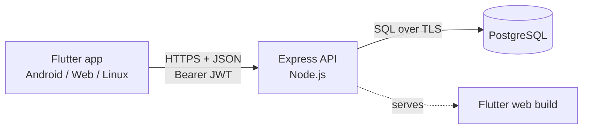

# SeatSure

Book library seats by time slot, with QR check-in and automatic release of
no-show bookings.

CPAD (R5CO4004L) ESE mini project, Chaitanya Shinde (231070066), B.Tech CE, VJTI.


## What it does

**Students**
- See every reading room with how many seats are free right now.
- Pick a day, start time and length; the seat map shows each seat as free,
  taken or yours, and refreshes every 15 s.
- Book a seat. The database guarantees nobody else holds it for that time.
- At the seat, scan the QR code on the desk to check in (or type the code
  printed under it).
- Miss the check-in window (15 min after the start) and the seat is released
  automatically for others.
- Leave early to free the seat, cancel a booking, see history.

**Librarian (admin)**
- Dashboard: seats in use now, waiting check-in, free; per-room bookings,
  attendance, no-show rate, seat-hours used; busiest hours.
- Every booking of a day with the student's name.
- Add rooms and seats, open/close a room, disable a seat.
- Printable QR sheet per room; issue a new QR for a seat (the old one stops working).

## Stack

| Layer | Tech | Why |
|---|---|---|
| App | Flutter 3 (Dart), Provider | One codebase for Android, web and Linux desktop |
| API | Node.js 24+, Express 5, zod, JWT | Small REST API; every rule is code we can show |
| Database | PostgreSQL 18 | Range types + exclusion constraints stop double booking inside the DB |
| Hosting | Render (Docker) + Neon (Postgres) | Free tiers, one public URL for API and web app |
| CI | GitHub Actions | API tests on real Postgres, Flutter tests, Docker image check |



## Where is X (code map)

| Thing | File |
|---|---|
| Tables, constraints (no double booking) | `api/migrations/001_init.sql` |
| Booking a seat (transaction, row lock, limit) | `api/src/routes/bookings.js` |
| QR check-in and its error reasons | `api/src/routes/checkin.js` |
| No-show release (lazy expiry) | `api/src/middleware/noShowSweep.js` |
| Time rules (15-min grid, 30 min–4 h, 7 days, opening hours) | `api/src/lib/slots.js` |
| Login, sign-up, password hashing | `api/src/routes/auth.js`, `api/src/lib/password.js` |
| Admin rooms/seats/stats | `api/src/routes/admin.js` |
| DB error → friendly 409 message | `api/src/middleware/errorHandler.js` |
| Demo data | `api/scripts/seed.js` |
| API tests | `api/test/*.test.js` |
| App start, theme, login gate | `app/lib/main.dart` |
| HTTP client, error handling | `app/lib/api/api_client.dart` |
| Login state, server address | `app/lib/state/session.dart` |
| My bookings state (book, cancel, check in) | `app/lib/state/bookings_model.dart` |
| Seat map + booking | `app/lib/screens/room_screen.dart` |
| QR scanner | `app/lib/screens/scan_screen.dart` |
| Admin screens | `app/lib/screens/admin/` |
| App tests | `app/test/` |
| Deployment | `Dockerfile`, `render.yaml` |

## Run it locally

Needs Node 22+, PostgreSQL, Flutter.

```sh
# 1. database (once)
psql -h 127.0.0.1 -U postgres -c "CREATE ROLE seatsure LOGIN PASSWORD 'seatsure_local'"
psql -h 127.0.0.1 -U postgres -c "CREATE DATABASE seatsure_dev OWNER seatsure"
psql -h 127.0.0.1 -U postgres -c "CREATE DATABASE seatsure_test OWNER seatsure"

# 2. API
cd api
cp .env.example .env
npm install
npm run seed        # migrate + demo data (npm run seed -- --bookings keeps seats/QRs)
npm run dev         # http://localhost:3000/api/health

# 3. app (another terminal)
cd app
flutter run -d linux                    # desktop, talks to localhost:3000
flutter run -d emulator-5554            # Android emulator, talks to 10.0.2.2:3000
flutter build web && WEB_DIR=../app/build/web npm --prefix ../api run dev   # web, same origin
```

Release APK pointing at the deployed API:

```sh
flutter build apk --release --split-per-abi --dart-define=API_BASE_URL=https://<your-app>.onrender.com
```

The app's **Server** screen (login page, top right) switches to another
address at runtime, e.g. a laptop on the same hotspot: `http://<laptop-ip>:3000`.

### Demo logins (after `npm run seed`)

| Role | Email | Password |
|---|---|---|
| Admin | admin@seatsure.app | Admin@1234 |
| Student | chaitanya@seatsure.app | Student@123 |
| Student | riya@seatsure.app | Student@123 |

## Tests

```sh
cd api && npm test        # 27 tests against the seatsure_test database
cd app && flutter test    # model + widget tests
```

The API tests include two parallel bookings of one seat (exactly one must
win) and parallel bookings by one student past the limit; both were checked
to fail when the protection is removed.

## API

All under `/api`. Send `Authorization: Bearer <token>` except for health,
config, register and login. Errors look like
`{"error": {"code": "seat_taken", "message": "..."}}`.

| Method | Path | Who | What |
|---|---|---|---|
| GET | `/health` | anyone | server + DB status |
| GET | `/config` | anyone | booking rules (grid, limits, check-in window) |
| POST | `/auth/register` | anyone | create a student account → token |
| POST | `/auth/login` | anyone | → token |
| GET | `/auth/me` | user | current user |
| GET | `/rooms` | user | open rooms + free-now counts |
| GET | `/rooms/:id/availability?start&end` | user | each seat free / taken / mine |
| GET | `/rooms/:id/timeline?date` | user | busy intervals per seat for a day |
| POST | `/bookings` | user | `{seatId, start, end}` → booking |
| GET | `/bookings/me?scope=upcoming\|history` | user | my bookings |
| POST | `/bookings/:id/cancel` | owner | cancel before check-in |
| POST | `/bookings/:id/checkout` | owner | leave early |
| POST | `/checkin` | user | `{qrToken}` → checked-in booking |
| GET/POST/PATCH | `/admin/rooms…`, `/admin/seats…` | admin | manage rooms, seats, QR codes |
| GET | `/admin/bookings?date` | admin | a day's bookings with names |
| GET | `/admin/stats?days` | admin | dashboard numbers |

## Deploy (Render + Neon)

1. Neon: create a project, copy the connection string.
2. Render: New → Blueprint → this repo. Paste the Neon string as
   `DATABASE_URL`. Render builds the `Dockerfile`, which builds the web app
   and runs migrations on start.
3. Open `https://<app>.onrender.com/api/health`. Seed once from a laptop:
   `DATABASE_URL=<neon url> DATABASE_SSL=true npm --prefix api run seed`.

Free Render services sleep after 15 minutes idle (first request then takes
up to a minute). Open `/api/health` a couple of minutes before a demo.
